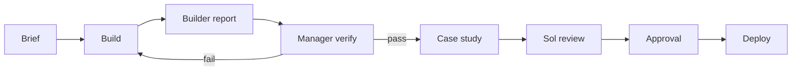

# Build Team

The manager coordinates. Sol advises. Builders implement inside one boundary.

## Roles

| Role | Model | Owns | Writes |
| :--- | :--- | :--- | :--- |
| Manager | OpenBot | Scope, integration, verification, commit, deploy gate | Any file, after builders stop |
| Sol | gpt-6.1-sol | Critique and build order | `docs/sol-*.md` only |
| Work builder | Codex | Work index and discovery | `work.html`, `app.js` renderWork, Work CSS |
| Study builder | Codex | One embed at a time | `labs/embed/<study>.html` |
| Evidence builder | Codex | Case study galleries and captions | `data/site.json` caseStudy, images |

## Rules

1. One owner per file per wave.
2. A new study gets a new file. Do not edit another builder's embed.
3. Builders do not commit, checkout, push, or deploy.
4. Builders write one report with status, files, numbers, screenshots, and risk.
5. The manager runs the pipeline and commits.
6. Sol reviews after integration, not during.

## Handoff

Each builder report answers:

- Status: done, partial, or blocked.
- Changed files.
- Measured numbers.
- Screenshot paths.
- Console and network errors.
- Remaining risk.

## Gates

## Current wave

- Work index: done.
- Viscous Orb embed: done.
- Fluid Ramp embed: done, candidate only.
- Contact route: done.
- Installation case: next.
