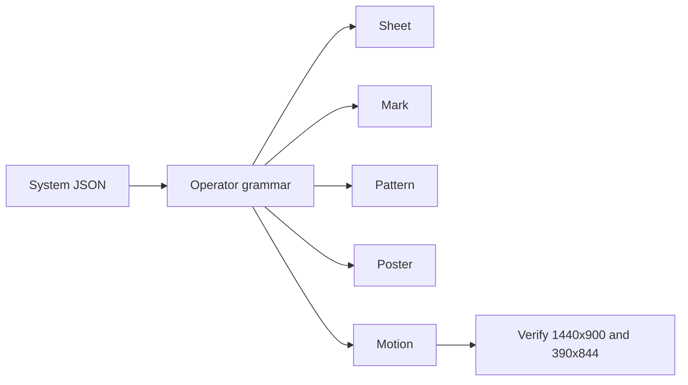

# Visual System Basis

This file sets the rule for every study. It takes the core of Flexible Visual Systems and turns it into a working grammar.

## The core

A visual identity is a small set of components and a small set of rules. The rules produce many outputs. The rule carries recognition. The output changes with format and medium.

**One form. One grammar. Many outputs.**

The source is Dr. Martin Lorenz, *Flexible Visual Systems* (Slanted, 2021; sixth edition), and the FVS School. The book draws on 10 years of research at the University of Barcelona, 16 years at TwoPoints.Net, and 20 years of teaching.

## What the method adds

| Layer | What it gives | Where it shows |
| :--- | :--- | :--- |
| Model | Components plus rules | System JSON plus renderer |
| Form-based | Recombination of a component set | Field operator |
| Transformation-based | One repeatable operation | Turn, mirror, scale, shift, shear |
| CAA | Components, assets, application | Sheet, then four outputs |
| Morphological box | Parameters as rows, values as columns | The table below |
| History | Manual, template, kit, program | Our system is a program |
| Grids | The grid becomes the transform tool | 4x4 and 6x6 fields |
| Type | Modular type and variable fonts | Next study |

The public course names four application moves. The paid lessons hold the detail. We do not invent them.

## The grammar

The system file holds values. The renderer holds the operators. This split is the whole method.

- Base form.
- Operator.
- Count.
- Step.
- Grid.
- Palette.
- Seed.

The morphological box from Zwicky and Gerstner is the design tool. A parameter is a row. A value is a column. A system is one selected column set.

| Parameter | Values | Quarter Turn |
| :--- | :--- | :--- |
| Base form | Quarter disc, square, triangle | Quarter disc, radius 0.55 |
| Operator | Turn, mirror, scale, shift, shear, field | All six |
| Count | 1 to 16 | 4, 2, 6, 6, 2, 16 |
| Step | 0 to 90 | 90, none, 0.13, 0.11, 20, none |
| Grid | 2x2 to 12x12 | 4x4, 6x6, 12x12 |
| Palette | Dark, light | Dark sheet, light poster |
| Seed | Any integer | 1 |

## One file, many renderers

`data/systems/quarter-turn.json` is the single source. It holds the base radius, six operators, the grid, and the palette.

The current renderer is `labs/embed/system-sheet.html`. It draws the operator sheet and four outputs.

Planned renderers read the same file:

- A sound patch reads count and step as rhythm.
- A projection map reads the grid as UV cells.
- A variable font reads one operator value as an axis.
- A Blender scene reads the base radius and the field count.

A new medium adds a renderer. It does not fork the system.

## The rules we keep

1. A study is a rule, not a picture.
2. Every output comes from the same file.
3. Every study passes desktop 1440x900 and phone 390x844.
4. Every case study reports a measured number.
5. The base form is ours. We do not reuse Atlas images or course text.

## Licence

Flexible Visual Systems is a method and a book. The site text, course lessons, and designer images are copyright Martin Lorenz and the named designers. We use our own forms and our own code. We credit the method in each case study. We do not label Atlas images as cleared.

## Sources

- https://flexiblevisualsystems.info/
- https://flexiblevisualsystems.info/about/
- https://flexiblevisualsystems.info/courses/
- https://martinlorenz.com/
- https://blog.coalesce.nyc/what-kirby-can-teach-us-about-flexible-visual-systems-6d95311c9aeb
- https://diposit.ub.edu/items/b2b74077-a365-4f9d-9545-5c7b44b343d5
- https://www.tesisenred.net/bitstream/handle/10803/365565/MARTIN_LORENZ_TESIS.pdf?isAllowed=y&sequence=1
- https://d-nb.info/1242343083/04
