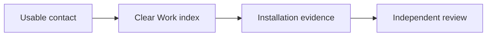

# Sol: next portfolio decisions

31 October 2026. I reviewed the eight requested files. I did not run browser or device tests.
I accept the hardened pipeline as the current baseline. All acceptance tests below describe future checks.

## Decision

Complete the contact route first, then the Work index, then an installation case study. Contact currently offers no address or request channel. That defect blocks every commission inquiry. Keep the Work builder active during the short contact task. Work remains the next substantial interface build because visitors need a clear route to existing evidence. Two case studies already exist; a third browser study adds less value than installation proof. Keep both hero builders on bounded adjustments. Their work must support project selection and artistic identity. Preserve four worlds. Treat Fluid Ramp as a candidate replacement, with Juan's approval before integration. The direction document still calls Warp's case missing; current data and status confirm its existence.

## Ranked build list

1. **Complete the contact route.** Impact: critical; visitors can start a conversation. Effort: small, about half a builder day after Juan supplies an address. Owner: Work index builder; OpenBot obtains Juan's publication approval. Add a visible, copyable address, a direct email link, and a specific invitation. State availability only with Juan's confirmation. **Acceptance test:** From home, Work, CV, and each case, a keyboard user reaches Contact and activates the correct recipient. Repeat at phone width. Check the address without sending a message.

2. **Complete the Work index and its home entry.** Impact: high; visitors can understand Juan's range and choose relevant proof. Effort: medium, two to three builder days with existing assets. Owner: Work index builder. Show project images, medium, Juan's role, and direct case links. Lead with one browser study and one installation. Keep worlds optional. Exclude Archived Works from the selected set. Preserve the approved palette. **Acceptance test:** Four of five unfamiliar reviewers identify Juan's practice and choose a relevant project within 15 seconds. Each reviewer reaches its case without carousel waiting. Confirm keyboard access, visible focus, readable phone layouts, and usable images when GPU rendering fails.

3. **Build the Forget Me Not case.** Impact: high; it proves collaboration, spatial judgment, and delivery beyond browser effects. Effort: medium, three to five working days after evidence collection. Owner: Juan supplies facts; a portfolio editor leads the case; the Work builder handles presentation. Use existing photographs with captions, a surface diagram, one constraint, one decision, and the installation result. Credit Victoria's artwork and Juan's projection mapping separately. Improve visual evidence in the two existing cases through the same structure. **Acceptance test:** An independent reviewer identifies Juan's contribution, the venue context, one consequential decision, and the result from linked evidence. Every external asset has a named source and permission basis. Never invent audience counts or recognition.

## Hero acceptance tests

**Viscous Orb — prove a signature interaction.** Owner: Orb builder. Capture identical views before and after the adjustment. At desktop and portrait sizes, show idle, pointer or touch disturbance, and recovery. The rim stays clear; dye responds to input; the dither control produces a visible difference. The reflection shows no repeating grid. Keep the title and Work link legible throughout. Ask three unfamiliar viewers to describe the relationship between the stable boundary and moving interior.

**Fluid Ramp — prove spatial cause and composition.** Owner: Fluid Ramp builder. Capture identical views before and after the adjustment. Show fluid striking the ramp, changing direction, and collecting within one continuous recording. Desktop and portrait crops must preserve that sequence. Keep the title and Work link clear. Ask three unfamiliar viewers to identify the ramp's effect without technical explanation. Submit a replacement proposal; do not add a fifth world.

For both tests, record ten seconds of actual renderer activity against the pipeline's declared performance budget. Save viewport, hardware, browser, and revision details. Test touch on a physical phone separately. Provide a static alternative and reduced-motion behavior. Pause must stop the artwork. Keep navigation usable when rendering fails.

## Missing roles

- **Art director:** connects the projects through a distinct artistic position and consistent visual judgment.
- **Portfolio editor and evidence producer:** develops case narratives, verifies credits, and secures installation documentation.
- **Interaction designer:** owns project discovery, case navigation, contact, and movement controls across the whole site.
- **Accessibility and performance reviewer:** independently tests keyboard use, assistive access, real devices, and failure behavior.

Assign responsibility before adding builders. Sol advises; builders implement; OpenBot coordinates approvals and delivery. These roles address current gaps; they do not guarantee an award.

## Cut list: 30 days

- Stop new worlds, shaders, and studies outside the two bounded hero adjustments.
- Stop broad visual redesigns and palette changes.
- Stop word quotas, decorative loaders, and parallel reel versions.
- Stop unsupported performance claims and award submissions before evidence review.
- Stop expanding the builder team before someone owns narrative, access, and final review.

## One question for Juan

Which email address do you approve for public commission inquiries?
