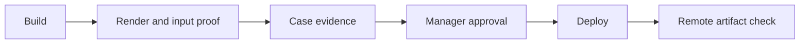

# Sol review — 31 October 2026

I reviewed source, saved reports, and both supplied screenshots. I also inspected saved phone captures.
Both pipeline files pass `node --check`. Memory-only fixtures reproduce three status defects without file writes.
I did not test the live site or physical devices. Awwwards page requests failed, so benchmark comparisons use the supplied research.

## Verdict

- Lead with selected work. Keep worlds inside projects and as an optional experience.
- The two studies show visual skill. Their case studies need visual evidence and artistic intent.
- The pipeline grants approval without sufficient proof. Correct its gates before trusting its status.
- The direction document mixes observations, preferences, stale facts, and unsupported performance claims.
- Delay an award submission. First prove Juan's contribution, physical practice, accessibility, and contact path.

## Score

**5/10.** This consultant score compares Juan with all twelve reference portfolios. It does not predict a jury result.

1. **Signature:** Colombel, Maria, and Emotion connect interaction with identity. Juan's worlds show skill but explain little about his artistic position.
2. **Evidence:** Marcus and Huy provide project context. Juan provides 309 and 325 case words, but neither study has a process gallery.
3. **Range:** Mirage and TWKS connect media with commissions. Juan's exhibition and XR pages lack equivalent case studies.
4. **Access:** Brandon and Gil establish clear project routes. Juan adds an introductory carousel and offers no contact address.
5. **Authorship:** Per, Sonya, and Signal-A demonstrate distinct presentation choices. Juan's restrained typography works, but repeated text grids weaken individual project identities.

Comparison evidence: `research/awwwards.md:17–28,34–82` in the supplied Project Studio workspace.

## Ranked findings

### Blocker — Contact has no usable destination

**Evidence:** `contact.html:16`; `data/site.json:375–377`.
The page offers contact details “on request” without a request channel.
**Impact:** A curator cannot start a commission conversation.
**Fix:** Add Juan's approved email address, availability, and one clear invitation.

### High — Technical copy contradicts implementation

**Evidence:** `data/site.json:46,51,53` claims compute wind, adaptive blade counts, and GPU generation for the remaining scene.
Wind runs in the vertex shader (`labs/engine/grass.wgsl:69,139–170`).
The engine fixes blade counts during creation (`labs/engine/grass-engine.js:48–54`).
CPU functions generate fields (`labs/engine/scene.js:308–329`).
**Impact:** A technical juror can challenge authorship and competence.
**Fix:** Describe actual render stages, fixed density, and CPU generation. Remove the physical-phone performance claim at `data/site.json:51`.

### High — Research does not establish the proposed formula

**Evidence:** `docs/portfolio-direction.md:18–23,31–42,72`.
The Awwwards report samples only five case pages (`research/awwwards.md:62`).
Its table includes four TWKS projects, below the direction's six-project minimum.
It reports 4–8 case sections; the direction invents an unsupported lower bound of two.
The hero type caps at 96px (`style.css:5`), while the direction lists 160px.
I found no supporting report for Fluid Ramp's 56.8 fps in the reviewed evidence.
**Impact:** Preferences acquire false numerical authority.
**Fix:** Label recommendations separately. Attach raw observations, measurement conditions, and report paths to numbers.

The unavailable Colombel site cannot validate carousel behavior (`research/awwwards.md:76,86`).
Eight selected motion winners cannot prove that reels underperform (`research/motion.md:62`).
Four projection entries cannot establish limited competition (`research/motion.md:86`).

### High — Credits and physical practice lack proof

**Evidence:** `data/site.json:69–71,113–119,193,260,365`.
“GLB asset” names no chair author or licence. The adapted solver credit lacks a source URL and licence.
**Impact:** Curators cannot separate Juan's decisions from borrowed assets or collaborators' work.
**Fix:** Add exact attribution, source links, permissions, contribution boundaries, installation photographs, and audience context.

### Medium — Documents disagree with current content

**Evidence:** `docs/portfolio-direction.md:19–21,53,71`; `pipeline/SLATE.md:6,15`; `index.html:46–50`.
Warp already has a case study. Four worlds exist, although the slate says three.
**Impact:** Workers receive conflicting priorities.
**Fix:** Generate the slate from validated project records. Date any historical baseline.

### Medium — Hero controls stop rotation, not the artwork

**Evidence:** `index.html:99–118`; `labs/engine/run.js:85–143`.
The pause button controls carousel timing. Grass animation continues, including under reduced-motion preferences.
World titles provide no case-study link (`index.html:29,94`).
**Impact:** Visitors cannot reliably stop movement or inspect the named work directly.
**Fix:** Make selected work the entry. Link each optional world to its case and provide a static alternative.

### Low — Typography needs refinement after content

**Evidence:** `style.css:4,17`; supplied case screenshots.
Small labels and repeated grids produce a uniform technical report appearance.
**Impact:** The presentation reduces differences between projects.
**Fix:** Preserve the palette. Improve reading hierarchy and place process images beside relevant decisions.

## Pipeline audit

Each item gives impact, correction, and a regression test. These tests describe required coverage; I did not run browser fixtures.

| Rank | Evidence and defect | Concrete fix and test |
| :--- | :--- | :--- |
| Blocker | `verify.mjs:167–198,238`: parent animation callbacks substitute for study rendering. Orb passes with null canvas and study (`reports/viscous-orb.json:11–19`). | Inspect the actual render frame. Require advancing render counters and visible output. Test an empty page and a broken child iframe; both must fail. |
| High | `verify.mjs:165–172,238`: readiness timeout and `study.error` never fail the gate. | Require readiness before timeout and no study error. Test an unavailable GPU adapter and permanent `ready:false`. |
| High | `verify.mjs:176–178`: an old positive FPS value can survive renderer failure. | Measure fresh counter deltas over a defined interval. Freeze rendering after one valid sample; require failure. |
| High | `verify.mjs:142–144,162,238`: the gate ignores collected network failures and navigation errors. | Check navigation results, required response statuses, and network failures. Abort a required fetch that the page catches; require failure. |
| High | `status.mjs:27–34`: any passing report grants verification, without matching revision, URL, required sizes, or budget. Warp's canonical report contains desktop only (`reports/warp-and-weft.json:6–30`). | Validate report identity, source revision, target, budget, and both sizes. Test stale, unrelated, and desktop-only reports; reject each. |
| High | `status.mjs:35`: shipped flags override every previous gate without approval or remote evidence. | Require all gates plus manager approval and a successful remote artifact check. Test shipped flags with no report; reject shipment. |
| Medium | `status.mjs:12–17`: whitespace and empty array entries count as a complete case. Images, measurements, and licences have no gate. | Validate meaningful fields and linked evidence. Test whitespace, three empty steps, two empty results, and `{}` credits; require incompleteness. |
| Medium | `status.mjs:32`: any href proves construction. | Check the local artifact or external target. Test `missing.html`; retain concept status. |
| Medium | `verify.mjs:37–47,54–59`: fixed port and profile can attach to another run's browser. | Use an isolated browser context and owned endpoint. Test concurrent runs and an occupied port. |
| Medium | `verify.mjs:84–95`: CDP requests lack deadlines and disconnect rejection. | Reject pending requests on timeout or closure. Disconnect Chrome during measurement; require bounded failure and cleanup. |
| Medium | `verify.mjs:155–160,238`: dimensions alone cannot prove phone interaction, accessible motion, or loading performance. | Add touch, keyboard, reduced-motion, overflow, and load-budget checks. Test a dead touch handler and an oversized asset. |

Pipeline references above use the `pipeline/` directory.
Prefer an established browser library for isolation and request deadlines.

## Case study critique

**What works:** Both screenshots show clear titles, coherent colour, and visible studies. Orb describes one failed texture approach.

**What is thin:** `app.js:98–116` renders four text blocks without visual process sections or evidence links.
`labs/live.css:25–26` confines desktop interaction to a narrow column and leaves substantial unused space.
Neither case offers a captioned comparison, next-project route, artistic stakes, or audience outcome.
The template does not yet support a convincing Awwwards submission.

Keep a shared structure with optional sections for venue, collaborators, installation constraints, audio, and XR device evidence.
Give film an edit and sound credit. Give projection a surface diagram. Give XR a recording of actual use.

Example opening for Orb:

> I wanted a sphere to contain moving liquid without losing its clear edge. The first reflection exposed a repeating texture grid. I replaced that texture with a fluid field that responds to the pointer. A coarse dither layer makes the liquid's movement visible. This browser study examines the tension between a stable boundary and an unstable interior.

## 30-day plan

1. **Restore trust — 7 November 2026.** Deliver corrected claims, exact credits, a usable contact path, and pipeline regression fixtures.
2. **Prove the practice — 21 November 2026.** Deliver three complete cases: one browser study, Forget Me Not, and one XR commission.
3. **Make work the entry — 30 November 2026.** Deliver a selected-work homepage and one finished motion piece with credited sound. Verify phone use.

## Cut list

Stop adding worlds for 30 days. Cut Fluid Ramp integration, mandatory word quotas, three simultaneous reel versions, and decorative loaders.
Remove Archived Works from selected work until its context warrants inclusion (`data/site.json:290–339`).

## Rejection risks and questions for Juan

A curator can reject the portfolio because the site hides the lived context and provides no contact route.
A jury can reject it because polished effects lack demonstrated originality, reliable measurements, and accessible alternatives.

- Which paid role should the portfolio attract first?
- Which installation best proves your responsibility and artistic judgment?
- Who created the chair, and what licence permits its use?
- Which email address can the site publish?
- What single artistic concern connects your browser, film, and exhibition work?
