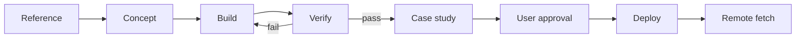

# Study Engine Pipeline

This pipeline turns one reference into one shipped study and one written case study.
It uses the site data file as the only content source.

## Stages

| Stage | Output | Gate |
| :--- | :--- | :--- |
| 1. Reference | Moodboard, three claims | One reference and one target image |
| 2. Concept | Premise, interaction, palette, budget | One sentence and one interaction |
| 3. Build | Study page under `labs/embed/` | Runs with no console error |
| 4. Verify | Screenshots and report | 1440x900 and 390x844 pass |
| 5. Case study | Brief, process, result, credits | Three images and one measured result |
| 6. Ship | Live URL | User approval, then remote fetch |

## Commands

```bash
# Verify a study at desktop and phone width.
node pipeline/verify.mjs --slug viscous-orb \
  --url http://127.0.0.1:8142/projects/viscous-orb.html

# Verify at three sizes and set a frame budget.
node pipeline/verify.mjs --slug viscous-orb \
  --url http://127.0.0.1:8142/projects/viscous-orb.html \
  --sizes desktop:1440x900,phone:390x844,portrait:1350x1800 --min-fps 55

# Check a page with no canvas (video or static page).
node pipeline/verify.mjs --slug surveillance-status \
  --url http://127.0.0.1:8142/projects/surveillance-status.html --page

# Build the status table.
node pipeline/status.mjs
```

Add `--full` to capture the whole page height. Use it to check a case study below the fold.

## Artifacts

- `pipeline/reports/<slug>.json` holds the last verification result.
- `pipeline/reports/<slug>/*.png` holds the screenshots.
- `pipeline/status.md` holds the current stage of every project.
- `data/site.json` holds the case study text and credits.

Reports are local artifacts. `.gitignore` keeps them out of the repository.

## Case study fields

```json
"caseStudy": {
  "brief": "One paragraph. The problem and the constraint.",
  "process": ["Step one.", "Step two.", "Step three."],
  "result": ["Measured result one.", "Measured result two."],
  "credits": [{"role": "Design and code", "name": "Juan Licerio"}]
}
```

## Rules

- Use measured numbers. Do not write "fast" or "smooth".
- Name the tool, the frame budget, and the input.
- Credit every collaborator and every library licence.
- Do not mark a study shipped before a remote fetch succeeds.

## Flow


