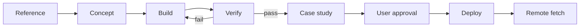

# Study Engine Pipeline

This pipeline turns one reference into one shipped study and one written case study.
It uses the site data file as the only content source.

## Stages

| Stage | Output | Gate |
| :--- | :--- | :--- |
| 0. Board | Component board or mood board in `labs/embed/` | Every component named, every rule written, one seed fixed |
| 1. Reference | Three claims from the board | One reference and one target image |
| 2. Concept | Premise, interaction, palette, budget | One sentence and one interaction |
| 3. Build | Study page under `labs/embed/` | Runs with no console error |
| 4. Verify | Screenshots and report | 1440x900 and 390x844 pass |
| 5. Case study | Brief, process, result, credits | Three images and one measured result |
| 6. Ship | Live URL | User approval, then remote fetch |

## The board gate

Every study starts with a board, not with a build. The board is a bento page of components drawn from the systems we have studied: Generative Gestaltung for rule-based modules, Flexible Visual Systems for components and operators, the Refik corpus method for data and provenance.

A board passes when all five are true:

1. It holds 6 to 12 components, each in its own cell.
2. Each cell prints its rule in one line, with the parameters named.
3. One seed is fixed and printed, and the board reproduces exactly from it.
4. At least three components come from a studied system, with that system named in the caption.
5. It runs at 1440x900 and 390x844 with no console error.

The product is then assembled from the board: a study picks components, not styles. Two worked examples: `labs/embed/component-board.html` and `labs/embed/forms-3d.html`.

## How Flexible Visual Systems fits the board

The board and FVS do different jobs, and both are needed.

- **The board is the inventory.** It lists the parts and writes down each rule. It answers "what exists".
- **FVS is the grammar.** It names the base form, the operators, and the parameter ranges, and it requires a series. It answers "how do the parts combine and vary".

| FVS role | Where it lives in a board | Example in `component-board.html` |
| :--- | :--- | :--- |
| Base form, held constant | One cell that never changes across outputs | 04 biomorphic outline |
| Operator | A transformation applied to the base | 02 resonance (combine), 05 division, 03 orbit |
| Parameter with a range | A value with a min and a max | 01 harmonic amplitudes, 09 sweep |
| Grid or field | The layout rule | 05 disc grid, 06 ramp |
| Surface treatment | How the form is rendered | 06 dither, 07 ASCII |
| Colour system | Palette as a parameter set | 08 combinations |
| Series | The same rule at N parameter steps | 09 harmonic series |

Three things FVS demands that a board alone does not:

1. **One base form stays constant.** If every cell is free, there is no identity, only a collection.
2. **Operators are named and bounded.** Turn 4 x 90 degrees, mirror, scale 6 x 0.13, shear plus or minus 20 degrees, field 4 x 4. A new output is then a decision, not a mood.
3. **A series, with a stop rule.** At least three valid variants, and a stated reason to stop when variation stops carrying meaning.

Worked pattern already in the repo: Quarter Turn. Base form is a quarter disc at radius 0.55; six operators; four outputs from one JSON file. The component board supplies the modules for the next one; FVS supplies the operator list.

## Commands

```bash
# Verify a study at desktop and phone width.
node pipeline/verify.mjs --slug viscous-orb \
  --url http://127.0.0.1:8142/projects/viscous-orb.html

# Verify at three sizes and set a frame budget.
node pipeline/verify.mjs --slug viscous-orb \
  --url http://127.0.0.1:8142/projects/viscous-orb.html \
  --sizes desktop:1440x900,phone:390x844,portrait:1350x1800 --min-fps 55

# Check a page with no canvas (video or static page).
node pipeline/verify.mjs --slug surveillance-status \
  --url http://127.0.0.1:8142/projects/surveillance-status.html --page

# Build the status table.
node pipeline/status.mjs
```

Add `--full` to capture the whole page height. Use it to check a case study below the fold.

## Artifacts

- `pipeline/reports/<slug>.json` holds the last verification result.
- `pipeline/reports/<slug>/*.png` holds the screenshots.
- `pipeline/status.md` holds the current stage of every project.
- `data/site.json` holds the case study text and credits.

Reports are local artifacts. `.gitignore` keeps them out of the repository.

## Case study fields

```json
"caseStudy": {
  "brief": "One paragraph. The problem and the constraint.",
  "process": ["Step one.", "Step two.", "Step three."],
  "result": ["Measured result one.", "Measured result two."],
  "credits": [{"role": "Design and code", "name": "Juan Licerio"}]
}
```

## Rules

- Use measured numbers. Do not write "fast" or "smooth".
- Name the tool, the frame budget, and the input.
- Credit every collaborator and every library licence.
- Do not mark a study shipped before a remote fetch succeeds.

## Flow


